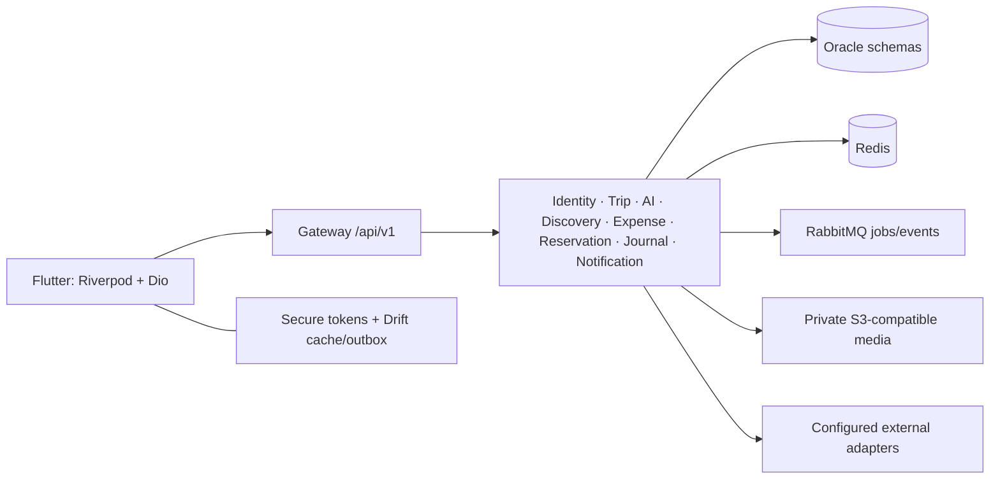

# Anajak integration

## Run

Backend: `cd C:\anajak_map\AnajakMapBackend\AnajakMapBackend`, then
`pwsh -File scripts/start-local.ps1` with Docker Desktop's Linux engine running.
Flutter: `cd C:\anajak_map\flutter_app`, then
`pwsh -File run-connected.ps1 -Target web` (or `-Target android` for an emulator).
Web uses `http://localhost:7777`; the only published backend port is gateway
`http://localhost:8080`. The mobile app never connects directly to Oracle.

The existing backend is preserved. Each of the nine services has its own Oracle
owner schema and restricted `_APP` runtime account. Flyway runs separately using
owner credentials; runtime Flyway is disabled. Redis, RabbitMQ and private media
storage remain internal to Docker. Existing `.env` and database volumes are retained.

## Feature and contract matrix

| Workflow | Flutter / backend connection | Boundary |
|---|---|---|
| Accounts | Redesigned auth, register with name/legal consent, verify/resend, login, refresh, logout, forgot/reset; profile preferences with version | Codes delivered only by email; Gmail SMTP implemented, sender and real legal URLs still required. See `flutter_app/AUTH_SETUP.md` |
| Trips | Paginated lists, create, edit `/trips/{id}/sync`, dates, IANA zone, budget | Original trip version retained; stale edits return 409 |
| AI itinerary | Queue/poll jobs, stop polling, resume by ID, edit/select activities, save draft, approve | Job must match trip; generation alone does not approve; approval carries draft + trip versions |
| Replanning | Current/proposed comparison, selected changes, reservation list, proposal approve/reject | No silent replacement; server rejects stale trip version; automated reservation-impact scoring is not implemented |
| Discovery | Search/list, food/culture/weather/routes/transport adapters, details, device-local bookmarks, reviewed itinerary addition | Development fixtures are labelled; real providers require configuration |
| Maps | `flutter_map`, backend coordinates, markers, selected-place details | Tile URL + attribution required; no fabricated map, bulk offline tiles, or route geometry |
| Expenses | Exact-decimal budgets, spending summary, accepted-member splits, conversion adapter, receipt upload/extract/review | Shares must equal amount; idempotency prevents replay duplicates; OCR is an adapter |
| Reservations | Manual records and private document upload/extract/edit/confirm; original zone + UTC instants | V3 migration allows manual records without a document; no booking purchase |
| Translation / companion | Text translation, saved phrases, conversations/messages, uploaded vision/voice media | Real translation/vision/voice need providers; voice file upload, not microphone recording |
| Groups | Account-ID invitation, acceptance, members, owner removal, activity voting, opt-in location | Accepted-member server authorization; location expires after five minutes; no invitation deep links yet |
| Journal | Create/edit, private photo upload/display, visited-place record, recap suggestion reviewed before save | Versions protect edits; Flutter deliberately avoids the legacy auto-saving recap endpoint |
| Calendar / transport | Events, conflict responses, explicit external sync, persisted journey legs | Provider setup required for external calendar/transport data |
| Offline | Drift snapshots: trip, approved activities/events, map points, contacts; queued trip edits, self-paid expenses and new journal entries | Account + gateway isolation, manual retry, retained failures, explicit conflict review; media/AI require network |
| Notifications | Reminder creation + persisted delivery status; repository device registration/revocation | Native push SDK and device-token acquisition are not configured; dev delivery is MOCK_DELIVERED |

The UI-only sample remains available with `--dart-define=APP_MODE=demo` and is
separate from connected state. Theme/language preferences and the existing design
system remain shared. Connected forms use reusable loading/error/validation states.

## Contract fixes in this integration

- Exact-origin gateway CORS for the local web port; credentials stay in bearer headers.
- Authenticated `/runtime` reports whether provider results are development fixtures.
- Manual reservation endpoint with idempotency, access validation and a nullable document migration.
- Itinerary approval accepts optional `baseVersion` for backwards compatibility;
  Flutter always supplies it. The server checks it while holding the trip lock.
- Generation status includes `TRIP_ID` to prevent applying a recovered job to another trip.
- Network-timeout tests initialize their HTTP client before measuring request deadlines.

## Recovery rules

Authentication tokens use secure platform storage. A rotating refresh is shared
between concurrent requests. Uploads are not blindly replayed after token refresh;
the user retries file selection. Creation forms retain idempotency IDs for an
unchanged payload. Errors preserve backend messages and trace IDs.

Downloaded data and pending operations are scoped by gateway URL and account ID.
An offline session may show previously downloaded content; all writes still need
backend authorization when replayed. Trip conflicts show both versions; the merge
form starts from current server values and requires deliberate edits. Expenses and
new journal entries replay with the original idempotency key. A lost trip-write or
approval response is reconciled against server state before declaring success.

Cache/outbox payloads are not separately encrypted. Browser storage is subject to
browser retention rules; downloads are not backups. Signing out clears local tokens even if server revocation cannot be reached; offline revocation therefore is not guaranteed. Signing out retains that
account's queued work. Native OS security and a production retention policy still
need device testing.

## Docker and Kubernetes

`scripts/start-local.ps1` supports Windows and builds Java inside Linux. The
default Oracle image is the backend's `gvenzl/oracle-free:23-slim-faststart`.
`-OfficialOracle` selects `compose.oracle-official.yml` for a fresh compatible
volume; never swap major database images over an existing volume casually.

The backend's pinned legacy MinIO images are unavailable from the original
registries. `compose.media-source.yml` rebuilds their tagged upstream source for
local compatibility. Use a maintained S3-compatible service for production.

Portable local Kubernetes manifests live in
`AnajakMapBackend/AnajakMapBackend/deploy/kubernetes`. They include Oracle with a
PVC, internal dependencies, service deployments/probes, separate migration Jobs,
secret preparation and a documented grant/start order. Application replicas start
at zero until migrations and runtime grants finish. There is no public ingress.
The existing remote OpenShift context has **not** been modified.

## Verification

- 6 October auth update: the Oracle consent migration and updated identity/gateway images are running locally. Six new auth backend tests and the 18-group live smoke suite pass; the latter used an isolated mail adapter and verified that app responses contain no codes. Normal mail configuration was restored and gateway readiness is UP. New Flutter auth state/layout tests and light/dark English/Khmer visual previews pass; Android debug APK builds. This update has not been installed on Samsung (disconnected), and iOS remains unbuilt. See `flutter_app/AUTH_SETUP.md`; earlier test claims below describe earlier revisions.
- Samsung SM-S918B / Android 16 (5 October 2026): debug build, installation and real-device integration test passed over USB port forwarding. Verified UI login, native secure-token restoration, trip idempotency, generation, explicit approval/version conflicts, calendar/map data, budgets/expenses/splits, receipt upload/extraction, reservation creation, journal image round-trip, discovery, persistent native SQLite snapshots/outbox isolation, and logout after UI disposal. Fixed a disposed Riverpod session callback found by this test. Nine connected contract/widget regression tests pass; analyzer is clean.
- Physical-device runner: `powershell.exe -NoProfile -ExecutionPolicy Bypass -File .\run-device.ps1` from `flutter_app`; add `-Test` for the device suite. The script sets USB port forwarding and a short Java socket directory. Tests create disposable backend records and clear only their own local test storage. Rerun without `-Test` to restore the normal app.
- Flutter 3.44.1 / Dart 3.12.1; dependencies resolved and locked.
- 26 combined Flutter unit/widget/contract tests passed, plus the opt-in live Flutter repository test.
- Connected English/Khmer login golden images: `flutter_app/test/goldens/connected_login_*.png`.
- Connected web build succeeded. A Flutter font-tree-shaking warning references Cupertino icons; Material rendering is covered by the visual tests.
- Linux Maven package/test run succeeded. Oracle-specific Java tests are conditional and skipped in that run; live integration is a separate check.
- Kubernetes manifests render with `kubectl kustomize`; no cluster deployment is claimed.
- Browser verification passed using the installed agent-browser executable directly: page rendering, registration, verification, login, trip creation, job polling, explicit approval, trip detail, and Drift snapshot download. No browser errors were reported. Earlier npm-wrapper timeouts were resolved by using the executable directly.
- Oracle 23.26 is healthy; all nine schemas migrated, restricted runtime grants applied, and all nine services are running. The complete backend smoke suite passed (18 workflow groups). The live Flutter test passed against the same gateway and Oracle, including the new manual-reservation and version-checked approval contracts. Exact-origin web CORS preflight returned 200.

Run `flutter test test/live_backend_test.dart --dart-define=RUN_LIVE=true` against
the local dev stack. It uses the real Flutter repositories and creates disposable
test accounts/records. The backend also includes `scripts/smoke.py` for broader
permissions, uploads, jobs and adapter checks.

## Remaining production requirements

Live provider credentials/adapters, map tile configuration, native push SDK,
external calendar setup, Android camera/location permission flows and release-build testing, iOS device/build testing, HTTPS,
database/media backup and restore drills, production image/security maintenance,
and a review of Khmer translations. Android debug validation does not establish release or iOS compatibility. The missing
React reference and actual Figma authoring were not supplied by this repository.

